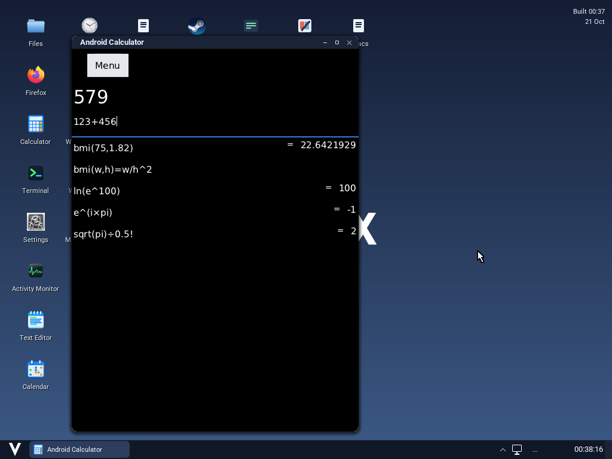
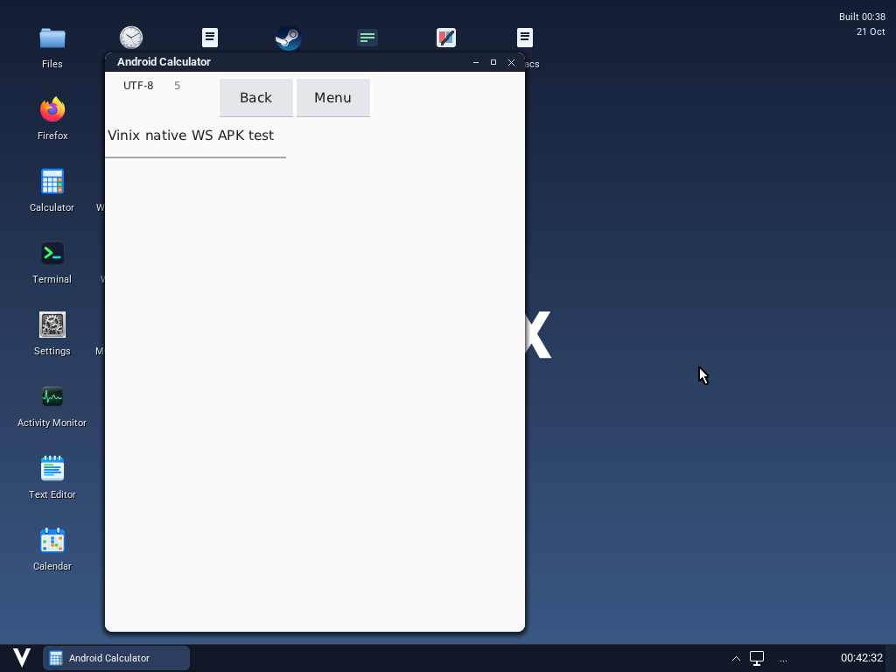
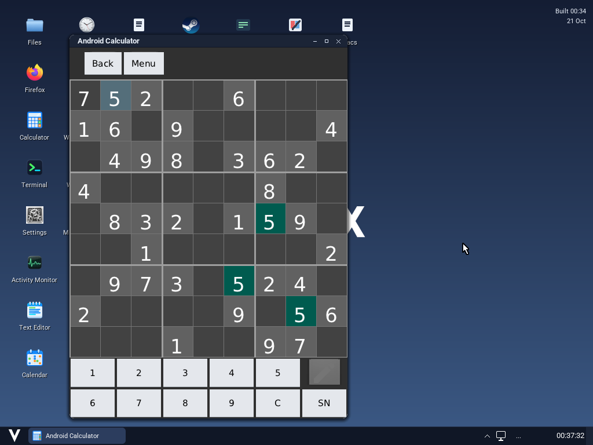

# Android APKs on Vinix

Vinix's ARM64 desktop runs Android APKs with
[Android Translation Layer](https://gitlab.com/android_translation_layer/android_translation_layer)
and ART. ART executes the application's DEX bytecode; ATL implements Android
framework APIs. The desktop uses a V backend that renders directly into a
Vinix WS surface and receives native WS input. GTK and X11 are absent from
this APK execution path. The runtime, its helpers and ARM64 JNI libraries
execute directly on the ARM64 CPU. Java bytecode
interpretation is provided by ART with its JIT disabled.

Vinix uses 16 KiB memory pages. The standard Alpine ART package assumes 4 KiB,
so the builder requires a source-built ART overlay adapted for 16 KiB pages.
The APK native-library linker also needs matching 16 KiB page rounding.
The source-built ATL overlay supplies matching native helpers, framework DEX,
Android resources and fonts from one pinned upstream commit. The Alpine
package's framework is replaced as a unit so its Java and JNI APIs stay in sync.
It verifies the pinned source, checked-in patch, compiler flag and every output
file's hash, architecture and load-segment alignment before staging it. A
missing or incompatible overlay fails the build. ART's androidfw library and
ATL are patched together to expose real NDK configuration snapshots and
qualifiers; rebuild both overlays when their checked-in patches change.

First build ART on a native ARM64 Alpine Linux host. On an ARM64 Mac, an ARM64
Linux VM using hardware virtualization is suitable for building the runtime.
ART's build generates and executes native host tools, so a macOS cross compiler
alone cannot build it. Enable Alpine's `edge/main`, `edge/community` and
`edge/testing` repositories and install its ART build dependencies:

```sh
apk add --upgrade build-base bash python3 zip curl pkgconf patch \
  bionic_translation-dev bsd-compat-headers expat-dev icu-dev java-common \
  libbsd-dev libcap-dev libpng-dev libselinux-dev libunwind-dev lz4-dev meson \
  openjdk8-jdk openssl-dev valgrind-dev wolfssl-jni-dev xz-dev zlib-dev vixl-dev
ln -sf python3 /usr/bin/python
```

The pinned dependency ABI uses musl `1.2.6-r4`, GCC/libstdc++ `15.2.0-r9`,
ICU `78.1-r0` and VIXL `8.0.0-r0`. Match the package lock when rebuilding;
the build script and manifest record the exact source, patch, compiler and
dependency packages. `--dependency-cache DIR` records available package
archive checksums for reproducing that build:

```sh
build-support/android/build-art.sh --output /path/to/art-runtime
build-support/android/build-bionic.sh --output /path/to/bionic-runtime
```

Build ATL on the same native ARM64 Alpine host with its framework dependencies.
The build uses OpenJDK 8 for Java compilation and Java 17 or newer for the
checksum-pinned D8 compiler:

```sh
apk add alsa-lib-dev android-build-tools art_standalone-dev libandroidfw-dev \
  gtk4.0-dev libgudev-dev libsecret-dev libdrm-dev libportal-dev \
  ffmpeg-dev mesa-dev openxr-dev sqlite-dev vulkan-loader-dev \
  wayland-dev wayland-protocols webkit2gtk-6.0-dev openjdk17-jre-headless
PATH=/usr/lib/jvm/java-8-openjdk/bin:$PATH \
  build-support/android/build-atl.sh --output /path/to/atl-runtime \
  --art-runtime /path/to/art-runtime --java /usr/lib/jvm/java-17-openjdk/bin/java
```

Copy all three resulting directories to the build host. Desugar ART's own Java
boot libraries using the pinned D8 compiler; this removes unresolved Java
lambda bootstrap calls while retaining the classes and resources. Application
APKs remain unchanged. This host step requires Java 17 or newer. Then stage
the native runtime and optional calculator APK. The staging host also needs
the maintained V compiler, curl and `aarch64-linux-musl-gcc`:

```sh
build-support/android/art-bootclasspath \
  --build-dir build-aarch64-android/aarch64/java-build --art-runtime /path/to/art-runtime
./scripts/build-android-aarch64.sh --art-runtime /path/to/art-runtime \
  --bionic-runtime /path/to/bionic-runtime --atl-runtime /path/to/atl-runtime \
  --with-calculator
./scripts/build-desktop-aarch64.sh --compact-initramfs --with-android
./scripts/run-desktop-aarch64.sh --no-build --mem=12288
```

The default ART overlay location is
`build-aarch64-android/aarch64/art-runtime`; the native-library linker defaults
to `build-aarch64-android/aarch64/bionic-runtime`, and ATL defaults to
`build-aarch64-android/aarch64/atl-runtime`. `VINIX_ANDROID_ART_RUNTIME`,
`VINIX_ANDROID_BIONIC_RUNTIME` and `VINIX_ANDROID_ATL_RUNTIME` override those
locations. The runtime builder installs the
checksum-pinned Alpine ARM64 dependency closure and patched ART under
`/opt/vinix-android-aarch64`. Its musl loader and libraries remain private
to APK processes. Upstream ATL build dependencies still include GTK, but the
native launcher does not load it or start an X server. It installs no CPU
translator. `packages.lock.json`,
`runtime-manifest.json`, `art-runtime-manifest.json`,
`bionic-runtime-manifest.json` and `atl-runtime-manifest.json` preserve provenance.
`--update-lock` explicitly regenerates the Alpine package selection.

The private libc is rebuilt from checksum-pinned musl 1.2.6 with the recorded
Alpine patches, heap retention and Android allocation accounting. Its build
must preserve the packaged libc's exports and use 16 KiB-compatible ELF
segments. `usr/share/vinix/musl-build.json` records its source, patch and payload
hashes; Android, Roblox and desktop staging verify that receipt.

Android's 80-byte ARM64 `mallinfo` reports actual live payload bytes, reusable
slot capacity, anonymous allocation-group mappings and peak mapped bytes.
Allocator metadata arenas are excluded. This private allocator leaves unused
ELF image-page space with its image so borrowed library backing cannot distort
heap statistics. Counters and allocation state share musl's fork lock. The
ordinary desktop allocator keeps its existing behavior.

Open **Android Calculator** from Start or Quick Launch. The sample is the
developer's unchanged Arity 1.1 APK, extracted from its
[official source archive](https://code.google.com/archive/p/arity-calculator/).
The archive and APK are verified against recorded SHA256 hashes. Click the
input field above the history list before typing; this version uses keyboard
input.



Vinix supplies the single title bar and window controls. Android menus, views,
dialogs and Canvas content render inside that native surface. The
[native WS backend](../build-support/android/nativews/README.md) describes the
implemented API subset, JNI build and surface protocol.

On 21 October 2026, native WS checks exercised these unchanged open-source
APKs through actual QMP keyboard/pointer input in an ARM64 Vinix guest:

| APK | Verified workflow |
| --- | --- |
| Arity 1.1 | Type `123+456` and inspect the application’s `579` result. |
| [Editor 1.98](https://github.com/billthefarmer/editor/tree/v1.98) | Enter edit mode through Activity recreation, type text, save through the filename dialog, clear the document, and reopen the saved file. |
| [Open Sudoku 2.5.2](https://gitlab.com/opensudoku/opensudoku/-/tree/2.5.2) | Open Easy and a puzzle, dismiss the reusable hints, select Single number mode, enter `7` by touch, return to the list, and reopen with that value retained. |





These are QEMU framebuffer captures. The test uses the existing **Android
Calculator** desktop launcher slot for each APK, so that outer caption remains
in the captures. The APKs supply the document editor, puzzle boards and data.
[Native workflow evidence and reproduction instructions](../tests/android/results/2026-10-21/native-ws/README.md)
record APK hashes, backend provenance, screenshots and serial logs. The guest
also inspects real process maps and rejects GTK/GDK/X11 libraries or X server
processes. Sudoku’s popup tabs and advanced operations are outside these checks.

The [V framework module](../build-support/android/atlframework/README.md)
implements the missing ActionBar, options menus, cursor adapter/lifecycle,
ListActivity row dispatch, callbacks and dialog behavior. Recreation delivers
the saved Bundle to a new Activity and restores EditText values with stable
IDs. The WS backend provides native views, software Canvas, in-surface dialogs,
asset reads, real SQLite queries and wakeable Looper queues. ScrollView commands
update native coordinates; smooth scrolling changes position immediately.
Themes apply a system base before app
overlays, buttons use their default style, and ICU charset enumeration excludes
converters the installed Java provider cannot construct. The normal ATL build
generates the JNI declarations and packages the V library with source/tool
hashes in its manifest. APK files are not patched.

These application checks do not establish complete runtime conformance or
mobile hardware support. The preserved runtime still fails the newer
`ANDROID-ATFORK-FAIL Android ABI exports` preflight. Rebuild matching overlays
for complete runtime qualification. The [earlier GTK workflow report](../tests/android/results/2026-10-21/README.md)
and [calculator report](../tests/android/results/2026-10-20/calculator.json)
remain historical evidence for that separate implementation.

The subsequent [popular-app startup matrix](../tests/android/results/2026-10-21/popular-ws/README.md)
probed eleven widely installed Google Play app identities. None reached a
usable UI on the native WS runtime. The report distinguishes standalone APKs
from limited base-APK probes, records exact versions and signatures, and
retains the first framework/JNI failure for each app. The Arity control still
calculated `579` through the same runner.

The desktop launches APKs with a WS surface and input pipe. Inside such a
native client connection, the public launcher accepts:

```sh
run-android /root/example.apk
run-android /root/example.apk -l com/example/MainActivity -w 480 -h 640
```

`-l` selects an activity using slash-separated names. `-w`/`-h` select surface
dimensions between 64 and 4096 pixels. The launcher requires
`VINIX_SURFACE_PATH` and WS input on stdin; an ordinary terminal does not
provide that connection. App data is stored under `$XDG_DATA_HOME/vinix/android`,
normally `$HOME/.local/share/vinix/android`. `ANDROID_APP_DATA_DIR` selects another root.
The launcher supplies a finite 32 MiB stack limit; `VINIX_ANDROID_STACK_KB`
overrides it. The compatibility library reports the usable initial stack
within both Vinix's mapped reservation and that limit. Worker stack metadata
remains supplied by musl. ARM ART uses its own low-address allocator for
compressed object references.

The private compatibility library also implements Android's DSO-associated
fork callbacks through real host callbacks. It preserves their order with
ART's callbacks and removes them when the Android library finalizes. Since
musl cannot unregister a host callback, the process retains an inert thunk
after finalization. The table supports 128 successful Android registrations
per process; further registrations return `ENOMEM`. Registering or finalizing
handlers from inside a running fork callback is unsupported.

Compatibility follows the implemented Android API subset. Pure Java/DEX APKs
do not require an architecture-specific native payload. Modern Android APIs,
services and resource qualifiers can require additional implementation; the presence
of an APK launcher does not establish compatibility with every application.
The native WS loader supports Linux JNI providers, not Bionic NDK or GLES APK
libraries. WebView only displays static HTML/text help content; modern web
apps, advanced drawing and text editing remain incomplete.

In the earlier GTK/ATL execution path, the unchanged Roblox 2.738.1397 APK
initializes its content providers and
completes the ARM64 engine's `JNI_OnLoad` through native ATL/ART. The coherent
framework, fork callbacks, real NDK configuration API, fortified I/O wrappers
and private allocator statistics resolve its earlier missing native imports.
Android resolver flags and EAI errors are translated at the Bionic boundary;
its native loader permits recursive constructor loads and retains the DSO
through callbacks. The launcher selects the private JKS trust store for Java
HTTPS. Native Vinix fixtures verify real public HTTPS and rejection of an
untrusted local certificate. XML `<requestFocus />` tags are consumed during
inflation and restore focus once children attach, respecting hidden views. The latest client launch then
aborts on the missing `View.OnCapturedPointerListener` API. A usable Roblox
screen, authentication and gameplay remain unverified. The [Roblox desktop entry](roblox.md) uses this
private ATL/ART runtime. Its Bionic/GLES launch is not covered by the WS checks.

The historical X11-oriented guest harness remains available for the legacy
ATL path and runtime preflights. It has not been ported to the WS backend;
use the native workflow procedure linked above for WS application checks:

```sh
build-support/run-v-tool.sh tests/android/launcher-test.v
tests/android/art-runtime-test
tests/android/bootclasspath-test
tests/android/musl-runtime-test
tests/android/run --memory 12288
```

The guest test opens the unchanged calculator APK in the Vinix desktop,
checks native stack and memory prerequisites, types `123+456` through the
guest keyboard, verifies that the APK draws `579`, and captures the actual
framebuffer. Its test-only text observer does not calculate the result or
modify the APK. Logs and screenshots are retained in `build/android-smoke`.
The native runtime passed this test on 3 October 2026 in both the minimal
test image and the built compact desktop image with 12 GiB RAM: the unchanged
APK displayed `579` with zero key retries. The Java boot probe also passed
date parsing, UTC formatting and stream ordering against the desugared boot
libraries. These results cover that APK and those Java platform calls.
`--observe --apk /path/to/app.apk` captures another APK's real window and logs
without claiming a functional pass. See [the harness instructions](../tests/android/README.md).
