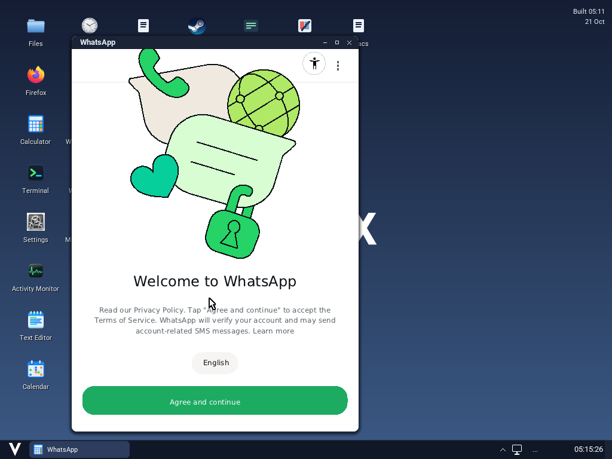
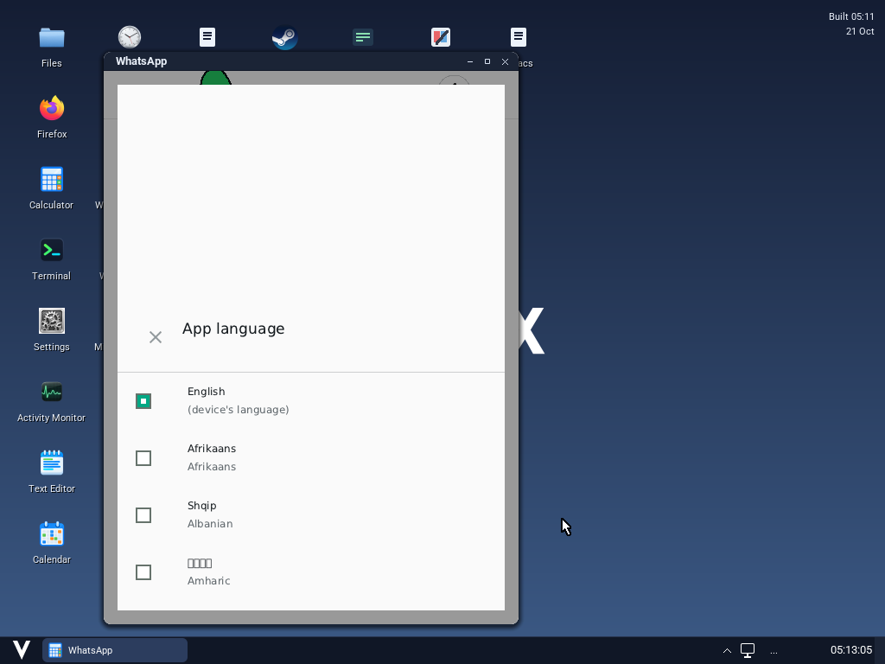

# WhatsApp on native Vinix WS — 2026-10-21

WhatsApp **2.26.41.78** reaches its welcome screen, scrolls, opens the language
selector, and changes language in an ARM64 Vinix QEMU guest. The tested sequence
selected Albanian and then restored English. The APK's DEX and native libraries
retain their publisher bytes. Vinix's native desktop owns the outer window;
process-map observations show GTK, GDK and X11 absent throughout the run.





This is a **startup and pre-account UI result**. WhatsApp's terms were not
accepted, and no phone number, account, SMS, messages, media or calls were tested.
The full-application `functional_passed` verdict remains null in
[results.json](results.json). The separate `startup_ui_passed` verdict records
the manually reviewed interactions above.

| Check | Result |
| --- | --- |
| Publisher APK startup, 240-second observation after launcher entry | Window observed; process remained alive; no harness failure markers |
| Welcome text, vector illustration, app button background and scrolling | Reviewed in QMP framebuffer captures |
| Language selector and language changes | Reviewed; returned to the English welcome screen |
| Runtime fixture in a fresh guest | Lifecycle, providers, clocks, NDK assets/bitmap access, Canvas pixels, HTML URL spans, wrapping, widgets and native notifications passed |
| 4 KiB native library on the 16 KiB guest | Fixture JNI calls passed; WhatsApp logged `Loaded: libwzav1.so` |
| Arity control in another fresh guest | Entered `123+456`, reviewed result `579` in [calculation capture](calculator-control-calculation.png) |
| Host loader tests | Three test files passed: fortified append, segment extents, copy mapping/BSS/RELRO/bounds/truncated input |
| Native notification service | Core tests and service authorization, migration, lifecycle and allocation checks passed |

The screenshots are QMP captures of the running guest. Compressed serial logs
retain the framework and app diagnostics. An early app-owned QPL initialization
message is caught by WhatsApp, which describes it as expected during startup.
Google service binding failures are also present; Google Play Services is not
installed. These observations do not establish account, push, network-service,
media or graphics compatibility.

The runtime fixes include Application/provider initialization, APK native-library
installation and loading, NDK assets and bitmap pixels, clocks, WebP, bitmap
Canvas targets, vector paths, local provider clients, native notifications,
multiline text and HTML anchors, CheckBox/RadioButton/ProgressBar, and scrolling
of AndroidX view groups. No-title themes retain their app-owned toolbar, and
the selected APK label supplies the outer title. EGL reports its unavailable
display/context state; imported GLES entrypoints do not provide a renderer.

The loader's 4 KiB compatibility path copies segments to their virtual offsets,
preserves shared-page bytes and BSS, and protects complete RELRO pages after
relocation. A 16 KiB page shared by executable and writable segments needs
combined permissions, including RWX. This is a compatibility limitation.

The test used QEMU/HVF, four ARM64 CPUs, 12 GiB RAM, 16 KiB kernel pages and the
existing private ART/core runtime. It rebuilt the V framework/backend, loader,
desktop and session broker. Kernel SHA256:
`a310a06243cd397bba18c8e594d55fb2c0cee4610b2fc64643e437720345da5e`.
The original framework JAR used for extension has SHA256
`4acb4a9356b7c0ed53498923e46fbe55acfabfe362f899a0a0a45bfd58f12357`.
Fresh core-runtime qualification and the earlier newer-fork ABI preflight are
outside these checks. Phone hardware, advanced text/layout, on-screen keyboards,
drag gestures, notification actions, background services, camera and EGL/video
remain unqualified.

APK input: `com.whatsapp`, version code `264107833`, version `2.26.41.78`, from
the publisher's HTTPS Android download at
<https://www.whatsapp.com/android/current/WhatsApp.apk>. The retained metadata
contains successful APK v2/v3 signature verification and certificate details.
APK SHA256:
`a6ef23a075243190255614f0ff71d1a39f935258a4eee9ef03e01823a3806748`.
The proprietary APK is kept outside Git. The publisher's current-download URL
can change; reuse the recorded input or reverify a replacement's identity,
version, signatures and hash.

[manifest.json](manifest.json) records the tested paths and guest settings.
The fixture is generated by
[bootstrap-fixture.v](../../../../native-android-ws/bootstrap-fixture.v).
Build the framework from the original JAR and compile the native backend with
the commands in the [backend README](../../../../../build-support/android/nativews/README.md).
Stage the updated desktop and `vinix-session` in the manifest's `native_dir`.
The [baseline harness instructions](../popular-ws/README.md) describe the private
VM preparation. Stop any owner of that boot image, copy the manifest and change
its `output` to a new directory, then run:

```sh
v -cc cc -cflags -O2 -o build/android-whatsapp/suite-fast tests/native-android-ws/suite.v
build/android-whatsapp/suite-fast path/to/copied-manifest.json
```

For the recorded 1024×768 desktop, move the pointer into the welcome body and
send three `wheel-down` taps with
[input.v](../../../../native-android-ws/input.v). Use QMP clicks on the visible
language controls and capture each settled screen. For Arity, focus its input,
send backspace taps to clear the example, type `123+456`, and wait for the result
before capturing. A live window alone never supplies a functional verdict.

`results.json` includes app metadata, image/log hashes and source/binary hashes.
The boot-image hash is explicitly the mutable image **after the final control**;
the driver replaces its runtime overlay for each fresh boot. Bionic and Mesa
receipts/NOTICES record pinned dependencies. The remaining logs record the
host loader, framework and native service checks.
