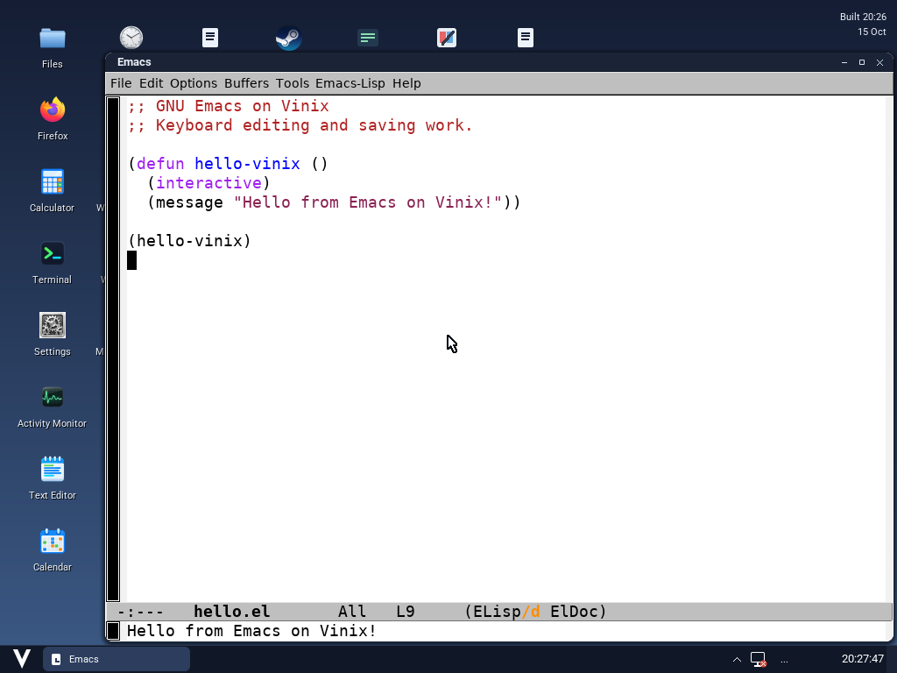

# Emacs on Vinix

GNU Emacs 30.1 runs as an unchanged native ARM64/musl Alpine X11 executable
inside a Vinix desktop window. Its portable dump, Lisp files, fonts and shared
libraries live in `/usr/libexec/vinix-emacs/root`; the launcher selects those
paths explicitly and leaves the system libraries alone. This uses the X11
build without native compilation.

On an ARM64 macOS host with V, LLVM, QEMU, mtools, ui2 at `../ui2`, the existing
ARM64 userland/X11 layers and an ARM64 Vinix kernel:

```sh
v -cc clang run build-support/stage-emacs.v build/emacs
v -cc clang run desktop/tools/build-emacs-demo.v
v -cc clang -path '@vlib|@vmodules|tests/hardware-platform|tests/linuxkpi|tools' \
    -o build/emacs/controller tests/emacs/run.v
VINIX_EMACS_KERNEL="$PWD/kernel/bin/vinix" build/emacs/controller
```

`VINIX_AARCH64_SYSROOT` selects the userland **staging** directory for the
cross-build. `VINIX_USERLAND_STAGING` and `VINIX_X11_STAGING` select guest
runtime inputs if those layers are elsewhere. `VINIX_UI2_SOURCE` selects ui2.
The builder snapshots committed desktop sources and overlays only the Emacs
changes, avoiding unrelated concurrent edits. `--clients-only` rebuilds the
launcher and guest init. `--check` runs the utility catalog, Start menu paging and
taskbar pinning regression suites against the snapshot.

The controller makes private boot media and a RAM-backed guest filesystem.
It first runs Emacs in batch mode, checking Lisp evaluation and a file write/read
round trip, then opens Emacs editing `/root/hello.el` in the desktop. It prints
`EMACS CHECK: ... PASS` for successful checks. The graphical edit check requires
real keyboard input, for example from another terminal:

```sh
build/emacs/controller key esc
build/emacs/controller key shift-dot
build/emacs/controller type ';; Keyboard editing and saving work.'
build/emacs/controller key ret
build/emacs/controller key ctrl-x
build/emacs/controller key ctrl-s
build/emacs/controller key esc
build/emacs/controller key x
build/emacs/controller type eval-buffer
build/emacs/controller key ret
build/emacs/controller shot
build/emacs/controller quit
```

The guest verifies that the text reaches the saved file. `shot` captures QEMU's
actual framebuffer to `docs/screenshots/emacs-vinix-qemu.png`; inspect both the
image and serial log. The private QMP socket is `/tmp/vinix-emacs-qmp`.

For a desktop image, merge `build/emacs/staging` into its staging tree after
building the desktop with these sources. The layer contains `run-emacs` and
the `vinix-emacs` multicall link. The desktop's Emacs entry then opens it;
`run-emacs -nw` also selects terminal mode.

The existing hosted input bridge does not decode modified navigation sequences
such as Ctrl+End; Emacs's `M->` and `M-<` work through Escape followed by `>`
or `<`. Native compilation, external language servers and network integrations
are outside this check.

Package versions, hashes and guest results are recorded in
[results/native-arm64.txt](results/native-arm64.txt) and
[the runtime manifest](results/alpine-runtime-packages.json).


