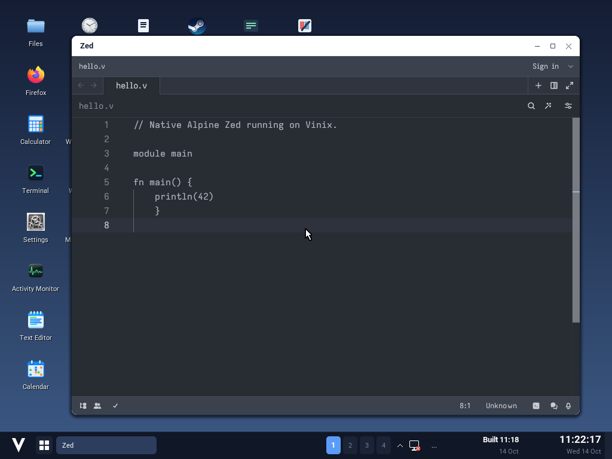

# Zed on Vinix

This workflow runs the unchanged native ARM64/musl Alpine Zed `0.138.4-r5` APK
inside a movable Vinix desktop window. The private runtime uses Alpine 3.22
libraries, Vulkan lavapipe, DejaVu fonts and X11 locale data. It does not replace
the desktop's musl or Mesa libraries. The APK is pinned by SHA-256 in
`build-support/stage-zed.v`; resolved dependency versions and hashes are written
to `build-aarch64-zed/packages.json`.

The historical APK is downloaded from an Alpine mirror because the current
edge/testing index no longer contains it. A current edge repository by itself
therefore does not supply this tested runtime. First boot recognizes
`/usr/bin/run-zed` when the staged layer is included in an image.

The launcher sets a same-size 60 Hz RandR mode because Xvfb's default mode has
zero timing fields, which this Zed release divides by. Its WebAssembly engine
also requires `MEMBARRIER_CMD_PRIVATE_EXPEDITED_SYNC_CORE`. Vinix implements
that command with an acknowledged GICv3 SGI rendezvous on ARM64. Each CPU
executes DSB/ISB before acknowledging. Registration belongs to the shared page
map; unregistered callers receive EPERM, and unsupported platforms advertise
zero through QUERY. The Apple AIC and x86 paths remain unsupported for this
particular command.

Use an ARM64 macOS host with V, LLVM, QEMU, mtools and the existing native
`build-aarch64-userland/staging`, `build-aarch64-x11/staging`, Limine and UEFI
artifacts. `VINIX_UI2_SOURCE` may select a ui2 checkout; the default is `../ui2`.

```sh
v -cc clang run build-support/stage-zed.v build-aarch64-zed
v -cc clang run desktop/tools/build-zed-demo.v
v -cc clang run tests/zed/build-kernel.v
v -cc clang -path '@vlib|@vmodules|tests/hardware-platform|tests/linuxkpi|tools' -o /tmp/vinix-zed-vm tests/zed/run.v
/tmp/vinix-zed-vm > /tmp/vinix-zed-serial.log 2>&1
```

The kernel build uses a detached worktree and separate objects, then copies only
the resulting binary into the demo directory. `VINIX_ZED_KERNEL` can select
another kernel that implements the synchronization command. The guest checks
the syscall ABI, issues 400 barriers from four simultaneous threads, and
publishes and executes actual ARM64 JIT code before launching the desktop.
Successful checks print `ZED CHECK: ... PASS`. Application and host logs are
forwarded to the serial log.

From another terminal in this repository:

```sh
/tmp/vinix-zed-vm shot
/tmp/vinix-zed-vm key ctrl-o
/tmp/vinix-zed-vm quit
```

`shot` asks QEMU to capture the real framebuffer to
`docs/screenshots/zed-vinix-qemu.png`.
`key` forwards a QEMU key combination; `type TEXT` types through the real guest
keyboard. A small demo-only launcher opens `/root/hello.v` through the shipped
launcher; normal desktop launches have no default document. `quit` stops only
this workflow's guest, whose QMP socket
is `/tmp/vinix-zed-qmp`. Inspect the image and application log before treating
a capture as successful; an error window is not proof that Zed runs.

Host integration checks:

```sh
v -cc clang run desktop/tools/test-app-selection.v zed app_selection
v -cc clang test build-support/zed/display
v -cc clang run tests/zed/build-kernel.v x86_64
```

The native ARM64 demo requires no desktop network access to open or edit local
files. It does not provide a D-Bus session, language servers or external account
services. Those integrations are separate from the validated editor window.

The checked capture and native package/kernel hashes are recorded in
[results/native-arm64.txt](results/native-arm64.txt), with the dependency lock in
[results/alpine-runtime-packages.json](results/alpine-runtime-packages.json).


